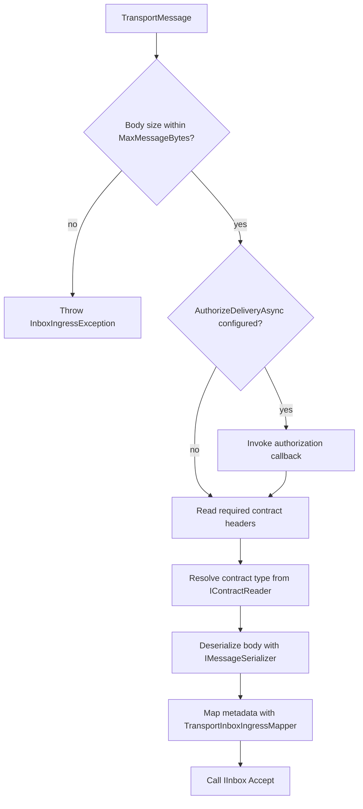

# Transport-to-Inbox Accept Handler

- **ID**: `ingress.transport-handler`
- **Name**: Transport-to-Inbox Accept Handler
- **Maturity**: GA
- **Summary**: The handler maps one `TransportMessage` delivery into `IInbox.AcceptAsync` or `AcceptBatchAsync`.

## Purpose and Scope

`TransportInboxIngressHandler` is the broker-neutral accept path. For each delivery, the handler validates body size and optional authorization, then reads the contract name and version from the LiteBus transport headers. It resolves the CLR type through `IContractReader`, deserializes the JSON body, maps headers to `InboxAcceptMetadata`, and calls `IInbox.AcceptAsync(InboxAcceptItem)`.

In batch mode, the handler builds an `InboxAcceptItem` per message and delegates to `IInbox.AcceptBatchAsync`. Both the single and batch paths wrap `TransportHeaderMappingException` as `InboxIngressException`, so invalid headers report the same exception shape on either path.

## Accept Pipeline

## Public Surface

| API | Role |
| --- | --- |
| `TransportInboxIngressHandler.AcceptAsync(TransportMessage, CancellationToken)` | Single delivery accept |
| `TransportInboxIngressHandler.AcceptBatchAsync(IReadOnlyList<TransportMessage>, CancellationToken)` | Batch store round trip |
| `AmqpInboxIngressHandler.AcceptAsync(AmqpReceivedMessage, CancellationToken)` | AMQP-shaped manual or test accept (delegates to inner handler) |
| `AmqpInboxIngressHandler.AcceptBatchAsync(IReadOnlyList<AmqpReceivedMessage>, CancellationToken)` | AMQP-shaped batch accept (delegates to inner handler) |
| `TransportInboxIngressMapper` | Internal mapper of wire headers to `InboxAcceptMetadata` |
| `TransportInboxIngressMappingOptions` | Internal mapping policy for `RequireStableIdentity` and `TrustApplicationHeaders` |

## Validation Behavior

| Check | Failure type | Policy impact |
| --- | --- | --- |
| Missing `litebus-contract-name` | `InboxIngressException` (wrapped mapping exception) | Non-requeue class by default policy |
| Invalid or non-positive `litebus-contract-version` | `InboxIngressException` (wrapped mapping exception) | Non-requeue class by default policy |
| Body exceeds `MaxMessageBytes` | `InboxIngressException` | Non-requeue class by default policy |
| Unknown registered contract | `MessageContractNotRegisteredException` | Non-requeue class by default policy |
| Invalid JSON payload | `JsonException` | Non-requeue class by default policy |
| Authorization callback throws | Callback exception type | Requeue or discard based on `IngressAckPolicy` |

## Packages

- `LiteBus.Inbox.Ingress`
- `LiteBus.Inbox.Ingress.Amqp` (`AmqpInboxIngressHandler` only)

## Requires

- `ingress.header-mapping`
- `ingress.safety-options`
- `durable-core.inbox-acceptance`
- `runtime.contract-registry`
- `runtime.message-serialization` ( `IMessageSerializer` )

## Invariants

- The required wire headers are `litebus-contract-name` and `litebus-contract-version` (a positive integer).
- Accept commits through the singleton inbox writer unless the host replaces store behavior.
- Deserialization uses UTF-8 body text from `TransportMessage.Body`.
- The transport consumer invoker owns process tracing, so the mapping handler does not create a second activity.
- The handler does not perform broker ack. Ack stays owned by the consumer loop.

## Non-Goals

- Broker acknowledgement (owned by `ingress.transport-consumer`).
- Handler execution or dispatch (inbox processor).
- Transactional accept in the same database connection as domain writes at the ingress edge.

## Observability

### Tracing

| Activity | Activity source | Kind | Started by | Tags |
| --- | --- | --- | --- | --- |
| `process {destination}` | `LiteBus.Transport` | Consumer | `TransportConsumerHandlerInvoker` around the delivery handler | Required messaging operation tags plus destination and message metadata |

The operation constant is `LiteBusTransportTelemetry.ConsumeOperationName`. Register with `TracerProviderBuilder.AddLiteBusTransportInstrumentation()` from `LiteBus.Transport.Extensions.OpenTelemetry`.

### Metrics

The handler does not increment ingress counters. Store accept outcomes surface through inbox processor metrics after the processor leases the row. Ack failure after accept is recorded in `ingress.transport-consumer` (`ingress.ack_failed_after_accept`).

### Logs

Mapping and contract validation failures throw before accept, and the consumer logs the discard or requeue decisions. There are no handler-specific structured log event IDs.

## Test Coverage

### Covered

| Test method | Project |
| --- | --- |
| `AcceptAsync_ShouldWriteEnvelopeToInboxStore` | `LiteBus.Inbox.UnitTests` (`Ingress/`) |
| `AcceptAsync_WhenBrokerRedelivers_ShouldNotCreateDuplicateRows` | `LiteBus.Inbox.UnitTests` (`Ingress/`) |
| `AcceptAsync_WhenBodyExceedsMaxMessageBytes_ShouldThrow` | `LiteBus.Inbox.UnitTests` (`Ingress/`) |
| `AcceptAsync_WithAuthorizationCallback_ShouldAuthorizeBeforeStoreWrite` | `LiteBus.Inbox.UnitTests` (`Ingress/`) |
| `AcceptBatchAsync_WithSingleMessage_ShouldWriteEnvelopeToInboxStore` | `LiteBus.Inbox.UnitTests` (`Ingress/`) |
| `AcceptAsync_ShouldDeserializeAndWriteToInboxWithMappedHeaders` | `LiteBus.Inbox.UnitTests` (`Ingress/Amqp/`) |
| `AcceptAsync_WhenContractHeaderMissing_ShouldThrow` | `LiteBus.Inbox.UnitTests` (`Ingress/Amqp/`) |
| `AcceptAsync_WhenContractVersionIsInvalid_ShouldThrow` | `LiteBus.Inbox.UnitTests` (`Ingress/Amqp/`) |
| `AcceptAsync_WhenContractVersionIsZero_ShouldThrow` | `LiteBus.Inbox.UnitTests` (`Ingress/Amqp/`) |
| `AcceptAsync_WhenMessageIsNull_ShouldThrow` | `LiteBus.Inbox.UnitTests` (`Ingress/Amqp/`) |
| `AcceptAsync_ShouldConvertByteArrayAndMemoryHeaders` | `LiteBus.Inbox.UnitTests` (`Ingress/Amqp/`) |
| `AcceptAsync_WhenMessageIdHeaderInvalid_ShouldLeaveInboxIdUnset` | `LiteBus.Inbox.UnitTests` (`Ingress/Amqp/`) |
| `AcceptAsync_WhenVisibleAfterHeaderInvalid_ShouldIgnoreVisibleAfter` | `LiteBus.Inbox.UnitTests` (`Ingress/Amqp/`) |
| `PublishThroughRabbitMq_ShouldAcceptProcessAndDispatchCommand` | `LiteBus.Durable.IntegrationTests` (`Ingress/Amqp/`) |
| `PublishThroughLavinMq_ShouldAcceptProcessAndDispatchCommand` | `LiteBus.Durable.IntegrationTests` (`Ingress/Amqp/`) |
| `PublishThroughKafka_ShouldAcceptProcessAndDispatchCommand` | `LiteBus.Durable.IntegrationTests` (`Ingress/Kafka/`) |
| `PublishThroughServiceBus_ShouldAcceptProcessAndDispatchCommand` | `LiteBus.Durable.IntegrationTests` (`Ingress/AzureServiceBus/`) |
| `PublishThroughSqs_ShouldAcceptProcessAndDispatchCommand` | `LiteBus.Durable.IntegrationTests` (`Ingress/AwsSqs/`) |
| `UseInMemoryIngress_ShouldAcceptProcessAndDispatchCommand` | `LiteBus.Durable.IntegrationTests` (`Ingress/InMemory/`) |
| `PublishThroughInMemoryTransport_ShouldAcceptProcessAndDispatchCommand` | `LiteBus.Durable.IntegrationTests` (`Ingress/InMemory/`) |
| `PublishThroughRabbitMq_ShouldStoreInPostgreSqlAndDispatchCommand` | `LiteBus.Storage.IntegrationTests (`PostgreSql/`)` |

### Untested

- `TransportHeaderMappingException` surfacing through the full consumer loop on live brokers.
- Multi-message `AcceptBatchAsync` through the handler alone (batch path exercised via consumer and AMQP integration).
- Header edge-case matrices on Kafka and Azure broker integration suites (InMemory suite carries the full matrix).

### Out-of-Scope

- Broker acknowledgement (owned by `ingress.transport-consumer`).
- Handler execution or inbox processor dispatch.
- Transactional accept coupled to domain database connections at the ingress edge.

## References

- [Inbox](../../reliable-messaging/inbox.md)
- [AMQP transport: Wire headers](../../integrations/amqp.md)
