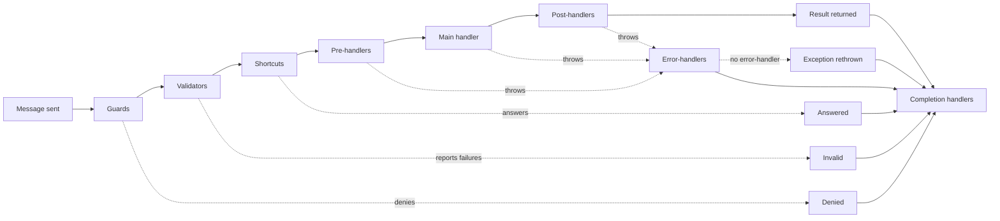

# The Handler Pipeline

Every message you send through LiteBus passes through the same pipeline: guards, validators, shortcuts, pre-handlers, main handlers, post-handlers, error handlers, and completion handlers. This page shows the order each stage runs in, how global and specific handlers interleave, and how you stop the work before it happens.

> **This page is for** a developer who registers a pipeline handler and wants to know where it runs.
>
> **After reading it** you can place each handler in the right stage and read the outcome it reports. For the validator stage in full, go on to [Validation](validation.md).

## The Stages

For one message, mediation runs these stages in this order:

1. **Guards** decide whether the message may proceed. A guard refuses by returning a verdict.
2. **Validators** decide whether the message is well-formed. A validator reports failures by returning a validity.
3. **Shortcuts** decide whether the answer is already known. A shortcut answers by returning a result, so the main handler never runs.
4. **Pre-handlers** prepare a message that is going to be handled. Throwing here stops the pipeline; returning cannot stop it.
5. **Main handler** does the work. One handler for commands and queries; all matching handlers for events.
6. **Post-handlers** react to success. They receive the message and the result.
7. **Error handlers** run only if an earlier stage threw. They receive the message, any partial result, and the exception.
8. **Completion handlers** run on every path, exactly once, and observe how the mediation ended.



A decision from any of the first three stages skips the main handler, the post-handlers, and the error handlers, and still reaches the completion stage.

Only the completion stage sees the whole story. A post-handler never runs when a handler throws, and an error handler never runs for a refusal or a cancellation. Put anything that must know how a message ended, such as an audit record, a metric, or the close of a unit of work, in the completion stage.

## Global, Specific, and the Execution Order

You can register a handler against the concrete message type or against a base type or interface the message implements. LiteBus calls the first kind **direct** (specific) and the second **indirect** (global or polymorphic). A handler for `IEvent` or a base command runs for every concrete message beneath it; see [Polymorphic Dispatch](polymorphic-dispatch.md).

The two kinds run in a fixed order that forms an onion around the main handler:

| Stage | Order |
| --- | --- |
| Guards | Global (indirect) first, then specific (direct) |
| Validators | Global (indirect) first, then specific (direct); every validator runs |
| Shortcuts | Global (indirect) first, then specific (direct) |
| Pre-handlers | Global (indirect) first, then specific (direct) |
| Main handler | The handler(s) for the message |
| Post-handlers | Specific (direct) first, then global (indirect) |
| Error-handlers | Global (indirect) first, then specific (direct) |
| Completion handlers | Priority order only; the direct and indirect sets are merged |

Within each group, handlers run in ascending `[HandlerPriority]` order (default priority is `0`). The pre/post asymmetry is deliberate: a global pre-handler such as authentication runs before any message-specific check, and a global post-handler such as audit logging runs after the message-specific reactions. Cross-cutting concerns wrap message-specific ones on both sides.

**Priority orders handlers inside a stage; it never reorders the stages.** Every guard runs before every validator, every validator before every shortcut, and every shortcut before every pre-handler, whatever priority each carries. [Deciding Whether the Work Happens](#deciding-whether-the-work-happens) explains what that fixed order buys you.

The completion stage is the exception. It merges both sets into one collection sorted by `[HandlerPriority]`, with registration order breaking ties. Completion handlers observe an ending rather than wrap the handler, so there is no onion for a specific handler to sit inside. That order decides whether your unit of work commits before or after the audit record is produced. See [Auditing](auditing.md#making-a-record-atomic-with-its-change).

A custom mediation strategy gets the same stage order through `RunAsyncPreStages` in the `LiteBus.Messaging` assembly. It tracks the outcome, the failure, and the reason as it runs, and passes all three to `RunAsyncCompletionHandlers` in a `finally`.

Each pre-handler, post-handler, and completion handler runs through the closed contract recorded in its descriptor at registration, so one class can implement pipeline contracts for several message types and each dispatch reaches the right one.

LiteBus also ships pipeline handlers of its own, such as the audit record writer. Those sit in a reserved priority band at or above `HandlerPriorities.ReservedFloor`, so a handler with no explicit priority always runs first. See [Handler Priority](handler-priority.md).

## Commands and Queries: The Single-Handler Pipeline

A command or query must resolve to exactly one main handler. Mediation throws `NoHandlerFoundException` when no handler survives filtering and `MultipleHandlerFoundException` when more than one handler at the winning level survives: direct handlers registered for the message win whenever any survive, and indirect handlers registered for a base type are considered only when no direct handler does. One direct handler plus one indirect handler resolves without throwing. Both exceptions name the runtime type of the message, even when the call erased it to `ICommand` or `IQuery`. The flow for a result-returning message is:

```text
decision = RunAsyncPreStages(message) // guards, validators, shortcuts, pre-handlers; stops on the first decision
result = handler.HandleAsync(...)   // the one main handler
RunAsyncPostHandlers(message, result) // direct post, then indirect post
RunAsyncCompletionHandlers(context)   // one priority-ordered pass, always, in a finally
return result
```

### What the Post Stage Is For

The post stage gives you two facts. A post-handler runs only when the main handler returned, and it runs before the completion stage, so before a commit at `HandlerPriorities.UnitOfWork`.

That is the slot for a reaction that belongs to the successful path and has to sit inside the transaction: publish the domain events an aggregate raised, enqueue an outbox message, or append to a projection the same commit flushes.

The commit itself does not belong there. A post-handler never runs when the main handler throws, so a commit placed there cannot decide anything about a failure, and everything LiteBus writes afterwards, including the audit record at `HandlerPriorities.Observability`, sits outside the transaction by construction. Commit from a completion handler at `HandlerPriorities.UnitOfWork` and gate it on `MessageCompletionContext.Outcome`.

A post-handler can replace the value the caller receives by setting `MessageResult` on the execution context. When a post-handler writes a non-null `MessageResult`, the caller receives that value instead of the handler's own result:

```csharp
public sealed class WrapInEnvelope : IQueryPostHandler<GetProductByIdQuery, ProductDto>
{
    public Task PostHandleAsync(GetProductByIdQuery query, ProductDto? result, CancellationToken ct = default)
    {
        AmbientExecutionContext.Current.MessageResult = new Envelope<ProductDto>(result);
        return Task.CompletedTask;
    }
}
```

Stream queries carry their own post-handler contract, `IStreamQueryPostHandler<TQuery, TQueryResult>`, typed over `IAsyncEnumerable<TQueryResult>`. It runs after the consumer has fully enumerated the stream, so the stream object it receives is already consumed: do not re-enumerate it unless its implementation supports it. To pass data from the stream handler to the post-handler, write to `IExecutionContext.Items` instead.

## Events: The Broadcast Pipeline

An event runs the decision stages and pre-handlers, then all matching main handlers, then post-handlers, then error handlers on failure. Main handlers group by priority and run according to the two concurrency switches on `EventMediationSettings.Execution`, covered on [Handler Priority](handler-priority.md) and the [Event Module](events.md).

If no main handler matches, publish still runs global and message-specific pre-handlers, then returns without post-handlers. Set `EventMediationSettings.ThrowIfNoHandlerFound = true` to throw `NoHandlerFoundException` after pre-handlers complete, which helps in tests that assert a handler exists.

## Error Propagation

When any stage throws a recoverable exception, the main flow stops and error handlers run. Each handler receives a typed `MessageErrorContext<TMessage, TResult>` backed by the shared outcome state, plus the caller cancellation token.

- If no error handler is registered, LiteBus rethrows the original exception with its stack trace preserved through `ExceptionDispatchInfo`.
- If error handlers run but leave `context.Outcome` as `Unhandled`, LiteBus also rethrows the original exception.
- A handler recovers by setting `context.Outcome` to `Handled`. For commands and queries that produce a result, it sets `context.HandledResult` to the fallback value the caller receives.
- A handler that sets `context.Outcome` to `Handled` on a result-bearing message without a usable `context.HandledResult` recovers the message, and the caller receives the default value (`null` for a reference type). Set `HandledResult` to hand the caller a fallback value instead.

An observing handler records the failure and leaves the default outcome unchanged, so the original exception still propagates:

```csharp
public sealed class AuditFailure : ICommandErrorHandler<ProcessPaymentCommand>
{
    public Task HandleErrorAsync(
        MessageErrorContext<ProcessPaymentCommand, object> context,
        CancellationToken cancellationToken = default)
    {
        // record the failure...
        return Task.CompletedTask; // the original exception still propagates
    }
}
```

## Deciding Whether the Work Happens

Three kinds of pre-stage handler can end a mediation before the main handler runs, and each answers a different question:

- A **guard** answers "may this happen". It refuses, and the refusal is security-relevant.
- A **validator** answers "is this well-formed". It reports failures, and malformed input is not a refusal.
- A **shortcut** answers "is this already done". It supplies the answer, and nothing was refused.

All three decide by returning a value rather than throwing, so the compiler requires the decision and nothing after it runs by accident.

| Decision | Returned by | Meaning | Reported outcome | Recorded by an audit trail as |
| --- | --- | --- | --- | --- |
| `Verdict.Allow` | a guard | The message may proceed | not applicable | not applicable |
| `Verdict.Deny(reason, code)` | a guard | The message is refused | `MediationOutcome.Denied` | a denial |
| `Validity.Valid` | a validator | Nothing is wrong | not applicable | not applicable |
| `Validity.Invalid(...)` | a validator | The message is malformed | `MediationOutcome.Invalid` | invalid |
| `Shortcut.None` | a shortcut | No answer; the mediation proceeds | not applicable | not applicable |
| `Shortcut.Answer(reason)` | a shortcut | The work was already applied | `MediationOutcome.Answered` | a success |
| `Shortcut<T>.Answer(result, reason)` | a shortcut | The result was already known | `MediationOutcome.Answered` | a success |

Separate contracts stop false entries in the list a security review reads: a cache hit refused nobody, a replayed idempotent command took effect the first time, and a malformed field is not an access decision. The split also lets the framework fix the order.

### Why the Order Is Fixed

The stage order is guards, then validators, then shortcuts, then pre-handlers, and no priority can change it. Each stage only sees input the previous one certified:

| Stage | Sees |
| --- | --- |
| Guard | Every message |
| Validator | Only messages the caller is allowed to send |
| Shortcut | Only well-formed messages the caller is allowed to send |
| Pre-handler | Only messages that are going to be handled |

Consider a cache registered globally for every query and an authorization check registered for one query. In a single pre-handler stage the global handler runs first, because indirect handlers precede direct ones, so the cache would answer a caller the authorization check would have refused. Priorities cannot fix that: every author would have to remember, and the indirect-before-direct rule would still apply. ASP.NET Core documents the same hazard for its own stack: `UseOutputCache` must come after `UseAuthorization`, or cached content reaches unauthorized users. Because LiteBus owns its stages, it makes that mistake unrepresentable instead of documenting it.

Validation sits between the two for the same reason. A malformed message must not claim an idempotency key or collect a cached answer, and an unauthorized caller should not learn from a validation message whether a resource exists.

Shortcuts run before pre-handlers for a different reason: a message that is about to be skipped should not pay for the enrichment it is about to skip. A shortcut that needs prepared state resolves it from the container.

### Guard Contracts

| Contract | For |
| --- | --- |
| `ICommandGuard<TCommand>` | Any command, whether or not it produces a result |
| `IQueryGuard<TQuery>` | Any query, including a stream query |
| `IEventGuard<TEvent>` | An event |

One contract covers every message, because a refusal does not owe the caller the value the handler would have produced. Where you hand back a failed result object instead of raising, that mapping lives in a [refusal mapper](#refusal-mappers) rather than in each guard.

```csharp
public sealed class RejectSelfApproval : ICommandGuard<ApproveRefundCommand>
{
    public Task<Verdict> DecideAsync(
        ApproveRefundCommand command,
        CancellationToken cancellationToken = default)
    {
        return Task.FromResult(command.ApproverId == command.RequesterId
            ? Verdict.Deny("the approver is the requester", code: "SELF_APPROVAL")
            : Verdict.Allow);
    }
}
```

A refusal always carries a reason and may carry a code, which a refusal mapper can switch on without parsing prose. The stage stops at the first refusal, because one reason is enough for a caller who may not proceed.

`LiteBusMessageDeniedException` does **not** reach error handlers. An error handler exists to recover from faults, and letting it see a refusal would let it undo one. The mediation still reports `Denied`, so the completion stage records it. The exception carries `DeniedBy` with the concrete guard type, and its message names that guard.

### Validator Contracts

| Contract | For |
| --- | --- |
| `ICommandValidator<TCommand>` | Any command |
| `IQueryValidator<TQuery>` | Any query, including a stream query |
| `IEventValidator<TEvent>` | An event |

```csharp
public sealed class TransferValidator : ICommandValidator<TransferCommand>
{
    public Task<Validity> ValidateAsync(
        TransferCommand command,
        CancellationToken cancellationToken = default)
    {
        var failures = new List<ValidationFailure>();

        if (command.Amount <= 0)
        {
            failures.Add(new ValidationFailure(
                "the amount must be positive",
                nameof(command.Amount),
                "AMOUNT_NOT_POSITIVE"));
        }

        if (string.IsNullOrWhiteSpace(command.Reference))
        {
            failures.Add(new ValidationFailure(
                "the reference must be supplied",
                nameof(command.Reference)));
        }

        return Task.FromResult(Validity.Invalid(failures));
    }
}
```

`Validity.Invalid(failures)` with an empty sequence is `Validity.Valid`, so a validator that finds nothing wrong needs no branch.

**This is the one stage that does not stop at the first decision.** Every validator runs, global and specific, and the stage gathers their failures into one result. A caller fixing a malformed message should not discover its problems one round trip at a time. Guards stop at the first refusal for the opposite reason: one reason is enough, and listing the rest would tell an unauthorized caller more than they should learn.

The failures reach the caller on `LiteBusMessageInvalidException.Failures`, and the mediation reports `MediationOutcome.Invalid`. Like a denial, an invalid message is a decision rather than a fault, so error handlers do not see it. It stays apart from `Denied` so malformed input stays out of the list a security review reads. The exception carries `RejectedBy` with the concrete validator type, and its message names that validator.

### Shortcut Contracts

| Contract | For |
| --- | --- |
| `ICommandShortcut<TCommand>` | A command that produces no result |
| `ICommandShortcut<TCommand, TCommandResult>` | A command that produces a result |
| `IQueryShortcut<TQuery, TQueryResult>` | A query |
| `IStreamQueryShortcut<TQuery, TQueryResult>` | A stream query |
| `IEventShortcut<TEvent>` | An event |

A shortcut over a message that produces a result returns `Shortcut<TResult>`, so the compiler checks the value you supply:

```csharp
public sealed class ServeProductFromCache : IQueryShortcut<GetProductQuery, ProductView>
{
    public async Task<Shortcut<ProductView>> TryAnswerAsync(
        GetProductQuery query,
        CancellationToken cancellationToken = default)
    {
        var cached = await _cache.TryGetAsync(query.ProductId, cancellationToken);

        return cached is null
            ? Shortcut<ProductView>.None
            : Shortcut<ProductView>.Answer(cached, "served from cache");
    }
}
```

For a stream query the answer is typed over `IAsyncEnumerable<TResult>`, so answering yields that stream instead of the handler. A shortcut that means the caller enumerates nothing answers with an empty sequence, which says so outright:

```csharp
return Shortcut<IAsyncEnumerable<Product>>.Answer(AsyncEnumerable.Empty<Product>(), "nothing to stream");
```

### Refusal Mappers

By default a refusal reaches the caller as `LiteBusMessageDeniedException` or `LiteBusMessageInvalidException`, because a method that must return a value has nothing to return. When you model failure as a value, register a mapper instead:

```csharp
public sealed class ResultRefusalMapper : ICommandRefusalMapper<ICommand, Result>
{
    public Result Map(ICommand command, Refusal refusal) => refusal.Outcome switch
    {
        MediationOutcome.Denied  => Result.Forbidden(refusal.Code, refusal.Reason),
        MediationOutcome.Invalid => Result.Invalid(refusal.Reason),
        _                      => Result.Failure(refusal.Reason)
    };
}
```

One registration against `ICommand` covers every command producing that result type. The mapping lives in one place rather than in each guard, which is why a guard supplies only the reason and the code it knows. A mapper registered against a concrete message wins over one registered against a base type; two mappers at the same level are a configuration error rather than resolved by assembly scan order.

Mapping is synchronous and must stay pure. It runs on the refusal path, where reaching for a database is exactly what the decision was trying to avoid.

| Contract | For |
| --- | --- |
| `ICommandRefusalMapper<TCommand, TCommandResult>` | A command that produces a result |
| `IQueryRefusalMapper<TQuery, TQueryResult>` | A query |
| `IStreamQueryRefusalMapper<TQuery, TQueryResult>` | A stream query |

The stream mapper is typed over `IAsyncEnumerable<TQueryResult>`, because the value a stream query produces is the stream itself. Returning an empty sequence hands the caller a refusal it enumerates as no items; without a mapper the refusal reaches the caller as an exception instead. Events have no mapper: an event produces no result, so there is no value a mapper could return, and a refusal there always raises.

### The Rules

- Everything after the stage that stopped the pipeline **does not run**: later decision stages, every pre-handler, the main handler, and every post-handler.
- The reason reaches completion handlers as `MessageCompletionContext.Reason`, and an audit trail as the reason on the record. Without a reason, an answered mediation leaves no explanation anywhere, because it reaches neither post-handlers nor error handlers. A denial always has one.
- For a message with a result type, a shortcut must supply a result. Using the untyped shortcut contract there throws `LiteBusConfigurationException` naming the typed contract to use instead. Because `ICommand<TResult>` derives from `ICommand`, the untyped contract compiles, so analyzer rule `LB1019` reports the declaration at build time. Guards and validators have no equivalent trap, because neither owes the caller a result.
- Error handlers do not run. Stopping is a decision, not a failure.
- A message that produces no result, and any event, has nothing a refusal mapper could return, so a refusal there always raises.

Deciding is a **capability**, which is why it lives in its own contracts. A plain `ICommandPreHandler<TCommand>` cannot stop the pipeline, so a pre-handler cannot skip the work by accident.

An event guard needs care. An event is a fact that already happened, so denying one is rarely meaningful. The useful case is `IEventShortcut<TEvent>`, which skips the reactions to an event this process already handled; to select handlers rather than stop the broadcast, use [Handler Filtering](handler-filtering.md).

### What Each Axis Offers

The three axes do not carry identical contracts, and the gaps are deliberate. Each one follows from what the axis is:

| | Command | Query | Event |
| --- | --- | --- | --- |
| Guard | yes | yes | yes |
| Validator | yes | yes | yes |
| Shortcut | `ICommandShortcut<T>` and `ICommandShortcut<T, TResult>` | `IQueryShortcut<T, TResult>` and `IStreamQueryShortcut<T, TResult>` | `IEventShortcut<T>` |
| Refusal mapper | yes | yes, including the stream form | no |
| Completion handler | yes | yes | yes |
| `EnableAuditing()` | yes | yes | yes, one record per publish |

One rule produces every gap in that table: **a contract that names a result exists only where the axis has one.** A query always produces a result, so it has no untyped shortcut. An event never produces one, so it has no typed shortcut and no refusal mapper: there is no value a mapper could return, and a denied event raises instead.

A new axis follows that rule rather than copying whichever axis it most resembles.

## Refusal as a Value

The ordinary mediator methods convert a denial and a validation failure to `LiteBusMessageDeniedException` and `LiteBusMessageInvalidException`, which leaves an HTTP endpoint catching an exception to produce a 403 or a validation problem response. The `Try` methods return the same ending as a value instead:

```csharp
Task<MediationResult> TrySendAsync(
    ICommand command,
    CommandMediationSettings? commandMediationSettings = null,
    CancellationToken cancellationToken = default);

Task<MediationResult<TCommandResult>> TrySendAsync<TCommandResult>(
    ICommand<TCommandResult> command,
    CommandMediationSettings? commandMediationSettings = null,
    CancellationToken cancellationToken = default);

Task<MediationResult<TQueryResult>> TryQueryAsync<TQueryResult>(
    IQuery<TQueryResult> query,
    QueryMediationSettings? queryMediationSettings = null,
    CancellationToken cancellationToken = default);
```

```csharp
var result = await commandMediator.TrySendAsync(command, cancellationToken: cancellationToken);

if (result.IsDenied)
{
    return Results.Forbid();
}

if (result.IsInvalid)
{
    return Results.ValidationProblem(result.Failures
        .GroupBy(failure => failure.Member ?? string.Empty)
        .ToDictionary(group => group.Key, group => group.Select(f => f.Message).ToArray()));
}
```

| Member | Meaning |
| --- | --- |
| `Outcome` | How the mediation ended. |
| `Reason` | Why the pipeline stopped, or `null` when nothing stopped it. |
| `Code` | The machine-readable code the decision supplied, or `null` when it supplied none. Switch on this rather than matching the reason. |
| `Failures` | Every failure the validator stage collected, or an empty list for any other outcome. |
| `IsSuccess` | `true` for `Succeeded` and `Answered`: an answered message succeeded, because the work had already been applied. |
| `Value`, `HasValue` | On `MediationResult<TMessageResult>`: the value the caller receives, and whether one was produced. Test `HasValue` before reading `Value`, because a refusal produces none. |

A genuine fault still throws. A database timeout is not something a boundary branches on, so the line stays where the pipeline draws it: a decision is a value, a fault is an exception.

Where a refusal mapper is registered, the mapped value arrives in `Value` alongside a denied outcome, so an application that models failure in its own result type sees both its value and the framework classification. This is not a replacement for a mapper: a mapper is for an application whose own result type models failure on every call, while `MediationResult` is for a caller that wants the framework answer and needs no type of its own.

### Evaluating Without Performing

`EvaluateAsync` asks what the guard and validator stages would say about a message, without performing it:

```csharp
Task<MediationDecision> EvaluateAsync(
    ICommand command,
    CommandMediationSettings? commandMediationSettings = null,
    CancellationToken cancellationToken = default);

Task<MediationDecision> EvaluateAsync(
    IQuery query,
    QueryMediationSettings? queryMediationSettings = null,
    CancellationToken cancellationToken = default);
```

```csharp
var decision = await commandMediator.EvaluateAsync(command, cancellationToken: cancellationToken);

approveButton.Visible = decision.IsAllowed;
```

`IsAllowed` reports that nothing objected, `IsDenied` that a guard would refuse, and `IsInvalid` that a validator would report the message malformed. `Outcome` carries only those three endings, because nothing was performed.

Evaluation runs guards and validators only. It deliberately never runs shortcuts or pre-handlers, because those act rather than decide: the shipped idempotency shortcut claims a key, so evaluating a page full of controls would burn keys for commands nobody submitted, and a cache shortcut would warm entries for reads nobody made. A message reported as permitted may still be answered from a cache when it is actually sent.

That puts one obligation on a guard: it must be free of effects a caller would not want from a "may I" question. A guard that loads an aggregate to decide is fine, and the load happens on every evaluation, so check the execution context data store before loading when it is expensive.

## Inspecting the Plan

`IMessageReader.Explain` reads everything registered for one message out of the registry, in the order the pipeline runs it:

```csharp
var plan = provider.GetRequiredService<IMessageReader>().Explain(typeof(ProcessPaymentCommand));
Console.WriteLine(plan);
```

Illustrative output:

```text
ProcessPaymentCommand
  guard               0  RequireSecondApproverGuard
  shortcut            0  SkipAppliedPaymentShortcut
  main                0  ProcessPaymentCommandHandler
  post                0  PublishPaymentProcessed
  completion  2000100  CommitUnitOfWork
```

`MessagePipelinePlan` carries the message type, the result type the message declares, and one `MessagePipelineStep` per handler. Each step names the stage, the priority that orders it inside the stage, the handler type, the closed contract the pipeline dispatches through, whether the handler was registered for a base type (`IsIndirect`), and whether the registry closed an open generic over the message (`IsClosedOpenGeneric`). A message with nothing registered produces a plan with no steps.

Tags are not applied. The plan describes what is registered; a mediation that filters by tag runs a subset of it. Call `Explain` from a unit test, a startup log line, or a management endpoint. It is for tests and diagnostics, not the hot path.

## Mediation Telemetry

Mediation records one span per message and a duration histogram, an outcome counter, and a decision counter through the `LiteBus.Mediation` activity source and meter. `MessageModuleBuilder.UseTelemetry` tunes what is recorded:

```csharp
liteBus.AddMessaging(messaging => messaging.UseTelemetry(new MediationTelemetryOptions
{
    StageSpans = true,
    StageMetrics = true
}));
```

| Option | Default | Records |
| --- | --- | --- |
| `Spans` | `true` | One span per mediation, named `mediate {MessageType}`. |
| `Metrics` | `true` | The duration histogram, the outcome counter, and the decision counter. |
| `StageSpans` | `false` | A child span per pre stage. Opt-in, because mediation volume is orders of magnitude above durable-processing volume. |
| `StageMetrics` | `false` | Per-stage durations. Opt-in for the same reason: one measurement per stage per message is four to five times the instrument traffic of one per message. |

`MediationTelemetryOptions.Disabled` records nothing, for a benchmark or a host that exports the same measurements through its own instrumentation. Instruments with no listener record nothing whatever is configured here, so register the source and the meter with an exporter through `LiteBus.Messaging.Extensions.OpenTelemetry`:

```csharp
builder.Services.AddOpenTelemetry()
    .WithTracing(t => t.AddLiteBusMediationInstrumentation())
    .WithMetrics(m => m.AddLiteBusMediationMetrics());
```

Only a `Failed` outcome sets the error span status. Denials and validation refusals keep a success status so error views show faults only. The instrument names are public constants on `LiteBusMediationTelemetry` and the full meter table lives in [Architecture](../architecture/README.md).

## Suppressing Post-Handlers

A shortcut skips the work. Once the work has happened there is nothing left to skip, but a handler can still stop the reactions to it. An idempotent command that detects it already ran should return the existing result without firing the post-handler that publishes its domain events:

```csharp
public Task HandleAsync(ProcessPaymentCommand message, CancellationToken cancellationToken = default)
{
    if (_ledger.AlreadyProcessed(message.PaymentId))
    {
        AmbientExecutionContext.Current.SuppressPostHandlers();
        return Task.CompletedTask;
    }

    // ...
}
```

Suppression differs from a pre-stage decision in three ways:

- It does **not** stop the calling handler. Everything after the call still runs, so there is no hidden control flow.
- You can call it from the main handler or from a post-handler, in which case the remaining post-handlers are skipped.
- The mediation still reports `MediationOutcome.Succeeded`, because the main handler ran.

That last point is the invariant to remember: **`Answered`, `Denied`, and `Invalid` mean the main handler never ran.** Reporting any of them for a suppressed post-handler chain would tell an audit trail that a command was refused when it actually took effect.

## Cancellation

Each handler method receives a `CancellationToken`. The token you pass to `SendAsync`, `QueryAsync`, or `PublishAsync` is the same token exposed as `AmbientExecutionContext.Current.CancellationToken`, so a handler without the token parameter can still observe it. Honor the token in any I/O or loop; LiteBus does not forcibly interrupt a running handler.

The token is a signal from the caller and the environment flowing inward: the client disconnected, a timeout elapsed, or the host is draining. It is not how a handler refuses a message. A refusal is a decision the pipeline makes and flows outward, which is why it belongs to a guard and reports `Denied`. Keeping the two apart lets an audit trail separate "the actor was not permitted" from "the client hung up", and it is why the completion stage is not cancellable.

## Sharing State Across Stages

Handlers in one mediation share an execution context. Use `AmbientExecutionContext.Current.Data` to pass a typed value forward, such as an aggregate a guard loaded to make its decision, and `Items` for string-keyed state such as a timer started in a pre-handler and stopped in a post-handler. [Execution Context](execution-context.md) covers the context in full.

## Completion: Observing How Mediation Ended

A completion handler runs in a `finally`, inside the ambient execution scope, after post-handlers on the success path and after error handlers on the failure path. It runs exactly once per mediation, whatever happened:

```csharp
public sealed class RecordCommandOutcome : ICommandCompletionHandler
{
    public Task HandleCompletionAsync(
        MessageCompletionContext<ICommand> context,
        CancellationToken cancellationToken)
    {
        // context.Outcome is Succeeded, Answered, Denied, Invalid, Failed, or Canceled.
        // context.Exception, context.Reason, context.Duration, and context.MessageResult carry the detail.
        return Task.CompletedTask;
    }
}
```

`MediationOutcome` names six endings, each one a state the message ended in:

| Outcome | When |
| --- | --- |
| `Succeeded` | The main handler and every post-handler ran without throwing |
| `Answered` | A shortcut answered without the handler, because the result was already known |
| `Denied` | A guard refused the message, carrying a reason |
| `Invalid` | A validator reported the message malformed, carrying its failures |
| `Failed` | The pipeline raised an exception other than cancellation or a refusal |
| `Canceled` | The mediation cancellation token was observed |

`Faulted` is shorthand for `Failed` or `Canceled`. A refusal is not a fault even when it reaches the caller as `LiteBusMessageDeniedException` or `LiteBusMessageInvalidException`, because it is a decision.

Three rules matter when you write one:

- **A completion handler observes; it cannot change the outcome.** The context is read-only, and the value the caller receives is already decided.
- **The stage is not cancellable.** Handlers receive `CancellationToken.None`, because the ending already happened and handing the stage the token that just fired would stop it recording exactly the cancellations it exists to record. Apply your own deadline if a handler needs one.
- **A completion handler that throws while an exception is already ending the mediation cannot replace it.** The fault is attached to the original exception under `MediationExceptionData.SuppressedCompletionFaults`, as an `IReadOnlyList<Exception>`, so nothing is lost. When no exception is ending the mediation, the fault propagates normally.

Register a handler for one message type with `ICommandCompletionHandler<TCommand>`, `IQueryCompletionHandler<TQuery>`, or `IEventCompletionHandler<TEvent>`; for a message that produces a result, the two-parameter form such as `ICommandCompletionHandler<TCommand, TCommandResult>` hands the result over typed. Register for every message on an axis with the non-generic `ICommandCompletionHandler`, `IQueryCompletionHandler`, or `IEventCompletionHandler`.

For streams, completion fires when the enumerator is disposed. A consumer who calls a stream query and never enumerates the result produces no completion record. That is inherent to iterators, and worth knowing if you audit reads.

## Next

Read [Validation](validation.md) for the validator stage in full, [Execution Context](execution-context.md) to share state and override results, and [Handler Priority](handler-priority.md) to order handlers within a stage.
