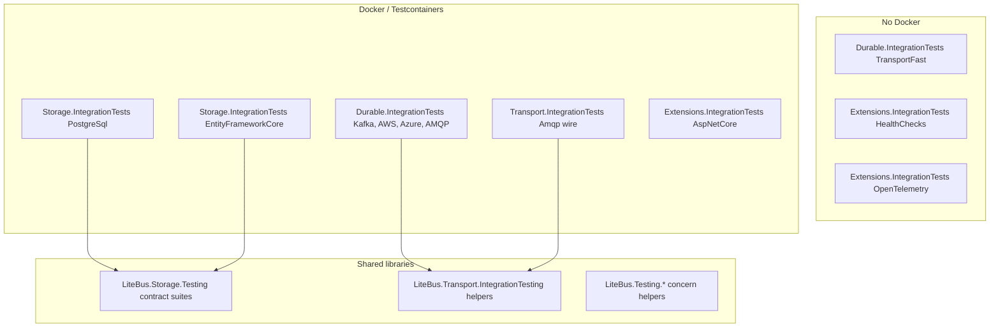

# Integration Tests

LiteBus integration tests prove broker, storage, and host-adapter behavior against real infrastructure such as containers and emulators. This page is the reference for those tests: which projects exist, what infrastructure each one uses, and which behavioral scenarios they prove. It is written for maintainers adding broker or storage coverage and for contributors running the suite locally or in CI.

For handler-level and in-memory processor recipes, see [Testing LiteBus](application-testing.md). For durable messaging setup snippets, see [Testing](README.md).

> [!NOTE]
> Project counts, trait names, and container images reflect the repository at the time this page was written. When in doubt, inspect `tests/` and `.github/workflows/ci.yml`.

## How Integration Tests Are Organized

LiteBus consolidates integration tests into four executor projects grouped by concern, plus shared helper libraries. Executors own broker, database, and host-adapter coverage organized in subfolders by technology. Tests prove outcomes: store row transitions, wire headers, processor passes, manifest registration, or HTTP responses. Registration smoke and fast in-memory wire cases live in `LiteBus.Durable.IntegrationTests`. The sample composition smoke test lives in `LiteBus.Runtime.UnitTests`.



### Executor Inventory

| Project | Path | Layer tested | Docker | Primary fixture |
|---------|------|--------------|:------:|-----------------|
| `LiteBus.Durable.IntegrationTests` | `tests/LiteBus.Durable.IntegrationTests/` | Broker ingress and dispatch (all brokers) | Per scenario | `KafkaBrokerFixture`, `LocalStackSqsFixture`, `ServiceBusEmulatorFixture`, RabbitMQ/LavinMQ fixtures |
| `LiteBus.Storage.IntegrationTests` | `tests/LiteBus.Storage.IntegrationTests/` | PostgreSQL inbox/outbox/saga storage, EF Core stores, schema, hosting | Yes | `PostgreSqlFixture`, `SqlServerFixture`, `MySqlFixture` |
| `LiteBus.Transport.IntegrationTests` | `tests/LiteBus.Transport.IntegrationTests/` | AMQP publish/consume/ack/nack wire behavior | Yes | `RabbitMqFixture`, `LavinMqFixture` |
| `LiteBus.Extensions.IntegrationTests` | `tests/LiteBus.Extensions.IntegrationTests/` | Management HTTP endpoints, health checks, OpenTelemetry | Partial | `PostgreSqlFixture` for AspNetCore; InMemory inbox for health |

### Folder Layout

```text
tests/
|-- LiteBus.Durable.IntegrationTests/
|   |-- Ingress/              # broker to IInbox (InMemory, Kafka, AwsSqs, AzureServiceBus, Amqp)
|   |-- Dispatch/
|   |   |-- Inbox/            # inbox processor to broker
|   |   `-- Outbox/           # outbox processor to broker
|   `-- Registration/         # Use*Dispatch / Use*Ingress resolve without live broker
|-- LiteBus.Storage.IntegrationTests/
|   |-- PostgreSql/           # reference PG store, schema, saga, reliable messaging
|   `-- EntityFrameworkCore/
|       |-- Inbox/
|       `-- Outbox/
|-- LiteBus.Transport.IntegrationTests/
|   `-- Amqp/                 # low-level wire protocol (no inbox/outbox)
|-- LiteBus.Extensions.IntegrationTests/
|   |-- AspNetCore/
|   |-- HealthChecks/
|   `-- OpenTelemetry/
|-- LiteBus.Runtime.UnitTests/
|   `-- Runtime/Composition/  # composition smoke (unit test, not integration)
|-- LiteBus.Transport.IntegrationTesting/   # shared fixtures, traits (not an executor)
|-- LiteBus.Transport.Testing/              # published transport contract suite
|-- LiteBus.Storage.Testing/                # abstract store contract suites
`-- LiteBus.Testing*/                       # concern-specific application test helpers
```

Supporting libraries (not test executors):

| Library | Role |
|---------|------|
| `LiteBus.Transport.IntegrationTesting` | Shared broker fixtures, xUnit traits, `DockerTestGate`, `FlakyInbox`, polling helpers, Kafka/AWS/Azure fixture hosts |
| `LiteBus.Transport.Testing` (`tests/`, also published as a package) | Abstract `TransportContractTests` suite for payload/header round trips, redelivery, and cancellation (not a vstest executor; `IsTestProject=false`) |
| `LiteBus.Storage.Testing` (`tests/`, also published as a package) | Abstract `InboxStoreContractTests`, `OutboxStoreContractTests`, retention contract suites, lease renewal ownership checks (not a vstest executor; `IsTestProject=false`) |
| `LiteBus.Testing` | Framework-neutral `ManualTimeProvider` and `LiteBusTestBase` |
| `LiteBus.Testing.DurableMessaging` | `AddInboxStoreRoles`, `AddOutboxStoreRoles`, in-memory host, and processor helpers |
| `LiteBus.Testing.Hosting` | Generic Host lifecycle and manifest helpers |

## Shared Infrastructure Patterns

### Testcontainers and Images

All Docker-backed fixtures use [Testcontainers for .NET](https://dotnet.testcontainers.org/) (central version in `tests/Directory.Packages.props`).

| Container | Image / module | Used by |
|-----------|----------------|---------|
| PostgreSQL | `postgres:16-alpine` via `Testcontainers.PostgreSql` | PostgreSQL storage, EF Core, AspNetCore management, and AMQP with PostgreSQL combos |
| SQL Server | `Testcontainers.MsSql` | EF Core inbox/outbox on SQL Server |
| MySQL | `mysql:8.4` via `Testcontainers.MySql` | EF Core inbox/outbox contract tests |
| RabbitMQ | `rabbitmq:4-management` via `Testcontainers.RabbitMq` | AMQP transport, ingress, dispatch, PG reliable messaging |
| LavinMQ | `cloudamqp/lavinmq` via generic `ContainerBuilder` | Second AMQP broker for compatibility |
| Kafka (Redpanda) | `docker.redpanda.com/redpandadata/redpanda:v24.3.7` via `Testcontainers.Redpanda` (default); Confluent via `Testcontainers.Kafka` when `LITEBUS_KAFKA_TEST_BROKER=confluent` | Kafka ingress, dispatch, outbox |
| LocalStack | `localstack/localstack:4.2` via `Testcontainers.LocalStack` | AWS SQS durable transport |
| Azure Service Bus emulator | `Testcontainers.ServiceBus` + `servicebus-emulator-config.json` | Azure durable transport |

### Fixture Lifetime

| Pattern | When used | Example |
|---------|-----------|---------|
| `ICollectionFixture<T>` | One expensive container per test collection | `KafkaBrokerCollection`, `ServiceBusEmulatorCollection`, `LocalStackSqsCollection` |
| `IClassFixture<T>` | One container shared by all tests in a class | `PostgreSqlFixture` in `Storage.IntegrationTests` and `Extensions.IntegrationTests` |
| Per-test fixture | Isolated broker when tests mutate queues or need clean state | `AmqpInboxIngressBatchIntegrationTests` creates its own `RabbitMqBrokerFixture` |
| Inline `new Fixture()` + `try/finally` | Composite scenarios (PostgreSQL + RabbitMQ in one test) | `PostgreSqlReliableMessagingEndToEndTests` |

### Docker Unavailable Behavior

Projects differ in how they handle a missing Docker daemon:

| Behavior | Projects | Mechanism |
|----------|----------|-----------|
| **Skip with message** | `Storage.IntegrationTests` (PostgreSQL, MySQL), `Transport.IntegrationTests`, `Durable.IntegrationTests` (AMQP, Kafka, AWS, Azure emulator) | Fixture records `IsAvailable = false`. Tests skip through `Skip.IfNot` with the fixture or `DockerTestGate` message. Durable broker tests throw instead when CI strict transport mode (`LITEBUS_CI_STRICT_TRANSPORT=true`) is enabled |
| **Throw after retries** | `Storage.IntegrationTests` (SQL Server) | Fixture throws `InvalidOperationException` after its container start retry loop |
| **No Docker needed** | `TransportFast` cases in `LiteBus.Durable.IntegrationTests`, health checks, OpenTelemetry | Always runs |

CI (`.github/workflows/ci.yml`) runs the suites as parallel shards, each on its own runner: unit tests without Docker (`FullyQualifiedName!~IntegrationTests`), the durable transport categories (`TransportFast`, `TransportDocker` for the durable and wire suites, `TransportAzure`), and the remaining integration tests (`FullyQualifiedName~IntegrationTests` excluding those categories and the opt-in `TransportLiveAzure` category), split by project, with PostgreSQL storage in its own shard and one shard for matching tests outside the integration projects. A coverage job merges every shard and enforces the 90 percent line gate.

### Environment Variable Overrides (Local Troubleshooting)

Fixtures can bypass Testcontainers when a connection string is already available:

| Variable | Bypasses |
|----------|----------|
| `LITEBUS_TEST_POSTGRES_CONNECTION_STRING` | PostgreSQL Testcontainers in `Storage.IntegrationTests`, `Extensions.IntegrationTests`, and AMQP+PG cases in `Durable.IntegrationTests` |
| `LITEBUS_TEST_MYSQL_CONNECTION_STRING` | MySQL Testcontainers in `Storage.IntegrationTests` EF Core contract tests |
| `LITEBUS_TEST_AZURE_SERVICEBUS_CONNECTION_STRING` + `LITEBUS_TEST_AZURE_SERVICEBUS_QUEUE` | Optional **live** Azure namespace tests only (`AzureServiceBusOptionalIntegrationTests`) |

Emulator-based Azure tests still require Docker. The environment variables do not replace the emulator fixture.

### Typical Test Shape (Durable Messaging)

Most inbox/outbox integration tests follow the same pipeline:

1. Build `ServiceCollection` through `AddLiteBus(builder => ...)`.
2. Register contracts, storage (`UseInMemoryStorage` or PostgreSQL/EF), and dispatch/ingress adapter.
3. For the ingress path, publish to the broker, then wait for the consumer before asserting store and handler state.
4. For the dispatch path, call `IInbox.AcceptAsync` or `IOutbox.EnqueueAsync`, run `ProcessPendingAsync`, and assert the broker message or handler side effect.
5. Assert on observable outcomes (row status, headers on wire, handler invocation), not on internal types.

---

## Broker-Backed Transport Integration Tests

- Executor: `tests/LiteBus.Durable.IntegrationTests/`
- Shared helpers: `tests/LiteBus.Transport.IntegrationTesting/`
- Subfolders: `Ingress/`, `Dispatch/Inbox/`, `Dispatch/Outbox/`, `Registration/` (grouped by broker: `InMemory`, `Kafka`, `AwsSqs`, `AzureServiceBus`, `Amqp`)

InMemory scenarios run without Docker. Kafka, AWS SQS (LocalStack), Azure Service Bus, and AMQP use Testcontainers.

### xUnit Categories (CI Filters)

| Trait | Constant | Docker | Scope |
|-------|----------|:------:|-------|
| `TransportFast` | `TransportTestTraits.Fast` | No | InMemory wire tests in `Ingress/InMemory/` and `Dispatch/**/InMemory/` |
| `TransportDocker` | `TransportTestTraits.Docker` | Yes | Kafka, LocalStack SQS, AMQP |
| `TransportAzure` | `TransportTestTraits.Azure` | Yes (emulator) | Azure Service Bus emulator |
| `TransportLiveAzure` | `TransportTestTraits.LiveAzure` | No local emulator | Optional live Azure namespace overlay with explicit credentials |

Registration smoke (`Registration/BrokerDispatchIngressRegistrationTests.cs`) has no category trait. It runs in the Integration Tests CI batch.

```bash
# Durable matrix only
dotnet test tests/LiteBus.Durable.IntegrationTests --filter "Category=TransportFast"
dotnet test tests/LiteBus.Durable.IntegrationTests --filter "Category=TransportDocker"
dotnet test tests/LiteBus.Durable.IntegrationTests --filter "Category=TransportAzure"
dotnet test tests/LiteBus.Durable.IntegrationTests --filter "Category=TransportDocker&FullyQualifiedName~Kafka"

# Full solution (matches CI)
dotnet test LiteBus.slnx --filter "Category=TransportFast"
dotnet test LiteBus.slnx --filter "Category=TransportDocker"
dotnet test LiteBus.slnx --filter "Category=TransportAzure"
dotnet test LiteBus.slnx --filter "Category=TransportDocker&FullyQualifiedName~Kafka"
```

### Fixtures per Broker

| Broker | Fixture | Collection | Notes |
|--------|---------|------------|-------|
| InMemory | None | N/A | Uses `UseInMemoryStorage` and in-memory transport modules |
| Kafka | `KafkaBrokerFixture` | `KafkaBrokerCollection` | Default Redpanda image; process-wide host via `KafkaBrokerSharedLifecycle`; per-test consumer group via `KafkaIngressTestSupport.CreateConnection`; override with `LITEBUS_KAFKA_TEST_IMAGE` or `LITEBUS_KAFKA_TEST_BROKER` |
| AWS SQS | `LocalStackSqsFixture` | `LocalStackSqsCollection` | Creates per-scenario queues via `CreateQueueAsync(prefix)` |
| Azure | `ServiceBusEmulatorFixture` | `ServiceBusEmulatorCollection` | Pre-declared queues in `LiteBus.Transport.IntegrationTesting/Azure/servicebus-emulator-config.json`; `IsAvailable` decides whether tests skip |

Pre-declared Azure emulator queues: `litebus-ingress`, `litebus-dispatch`, `litebus-outbox`, `litebus-fail`.

### Shared Test Messages

Defined in `TransportTestMessages.cs` under `LiteBus.Transport.IntegrationTesting`:

| Type | Used for |
|------|----------|
| `RemoteWorkCommand` | Inbox dispatch (processor publishes to broker) |
| `ShipOrderCommand` | Inbox ingress E2E (broker to accept to handler) |
| `OrderSubmittedIntegrationEvent` | Outbox dispatch |

### Scenario Classes (by Folder)

#### InMemory (`Ingress/InMemory/`, `Dispatch/Inbox/InMemory/`, `Dispatch/Outbox/InMemory/`)

| Test class | Scenarios |
|------------|-----------|
| `InMemoryInboxDispatchIntegrationTests` | Inbox processor publishes leased envelope to in-memory destination with headers |
| `InMemoryOutboxDispatchIntegrationTests` | Outbox processor publishes event; full header propagation; contract-name route fallback |
| `InMemoryInboxIngressModuleIntegrationTests` | `UseInMemoryIngress` E2E accept to process to dispatch. A running Generic Host keeps healthy ingress and dispatch active while an unrelated publisher circuit is open |
| `InMemoryIngressFailureIntegrationTests` | Unknown contract, invalid JSON, store full (no broker write) |
| `InMemoryIngressHeaderEdgeCaseIntegrationTests` | Missing/wrong contract headers, invalid MessageId, wrong CLR shape |
| `InMemoryIngressIdempotencyIntegrationTests` | Duplicate MessageId to single inbox row |
| `InMemoryIngressRequeueBehaviorIntegrationTests` | `RequeueOnFailure` on/off with transient failures |

#### Kafka (`Ingress/Kafka/`, `Dispatch/Inbox/Kafka/`, `Dispatch/Outbox/Kafka/`)

Shared infrastructure lives in `tests/LiteBus.Transport.IntegrationTesting/Kafka/` (`KafkaBrokerHost`, `KafkaBrokerFixture`, `KafkaIngressTestSupport`, `KafkaTransportTestInfrastructure`).

Ingress tests run production `TransportInboxIngressConsumer` and `InboxProcessorBackgroundService` through `ExecuteAsync` on background tasks. Short-lived test hosts call `DisposeProviderSafelyAsync` before tearing down Kafka clients because `IHostedService` orchestration can block on librdkafka shutdown.

| Folder | Test class | Scenarios |
|--------|------------|-----------|
| `Ingress/Kafka/` | `KafkaInboxIngressEndToEndIntegrationTests` | Publish to ingress to processor to dispatch |
| | `KafkaInboxIngressFailureIntegrationTests` | Unknown contract, invalid JSON, and store full, with transient seek redelivery |
| `Dispatch/Inbox/Kafka/` | `KafkaInboxDispatchIntegrationTests` | Inbox dispatch to Kafka topic with headers |
| `Dispatch/Outbox/Kafka/` | `KafkaOutboxDispatchIntegrationTests` | Outbox dispatch with contract-name route fallback |
| | `KafkaDispatchFailureIntegrationTests` | Unreachable broker and circuit breaker |

Header edge cases, duplicate MessageId idempotency, and full requeue on and off coverage are in `Ingress/InMemory/` and `Ingress/AwsSqs/`. The Kafka Docker suite adds end-to-end flow, failure paths, and `TransientAcceptFailure_ShouldRedeliverSameOffsetWithoutRestart` (partial requeue-enabled redelivery via seek).

#### AWS SQS (`Ingress/AwsSqs/`, `Dispatch/Inbox/AwsSqs/`, `Dispatch/Outbox/AwsSqs/`)

| Test class | Scenarios |
|------------|-----------|
| `AwsSqsInboxIngressEndToEndIntegrationTests` | SQS to ingress to handler |
| `AwsSqsInboxIngressFailureIntegrationTests` | Unknown contract, invalid JSON, store full |
| `AwsSqsIngressIdempotencyIntegrationTests` | Duplicate MessageId |
| `AwsSqsIngressHeaderEdgeCaseIntegrationTests` | Header edge cases (SQS-specific MessageId behavior) |
| `AwsSqsIngressRequeueBehaviorIntegrationTests` | Requeue disabled (drain) compared with enabled (transient store failure via `FlakyInbox`) |
| `AwsSqsInboxDispatchIntegrationTests` | Inbox dispatch to SQS |
| `AwsSqsOutboxDispatchIntegrationTests` | Outbox dispatch with contract-name route fallback |
| `AwsSqsDispatchFailureIntegrationTests` | Unreachable broker and circuit breaker |

#### Azure (`Ingress/AzureServiceBus/`, `Dispatch/Inbox/AzureServiceBus/`, `Dispatch/Outbox/AzureServiceBus/`)

| Test class | Scenarios |
|------------|-----------|
| `AzureServiceBusInboxIngressEndToEndIntegrationTests` | Emulator ingress E2E |
| `AzureServiceBusInboxIngressFailureIntegrationTests` | Unknown contract, invalid JSON, store full |
| `AzureServiceBusIngressRequeueBehaviorIntegrationTests` | Requeue enabled (transient store failure via `FlakyInbox`) |
| `AzureServiceBusInboxDispatchIntegrationTests` | Inbox dispatch with full LiteBus headers |
| `AzureServiceBusOutboxDispatchIntegrationTests` | Outbox dispatch with contract-name route fallback |
| `AzureServiceBusOptionalIntegrationTests` | **Live namespace only** when the environment variables are set; skips otherwise |

#### Registration (`Registration/`)

| Test class | Scenarios |
|------------|-----------|
| `BrokerDispatchIngressRegistrationTests` | `[Theory]` over every broker `Use*Dispatch` and `Use*Ingress` extension. It asserts that `TransportInboxDispatcher`, `IMessageConsumer`, and the other registrations resolve without a live broker |

### Ingress Ack Policy (Cross-Broker)

`TransportInboxIngressConsumer` discards (no requeue) when acceptance throws:

- `MessageContractNotRegisteredException`
- `InboxDispatchException` (missing or invalid transport headers)
- `InboxStorageException` (capacity or persistence rejection)
- `InvalidOperationException`, `ArgumentException`, `FormatException`, `JsonException`

Other failures honor `RequeueOnFailure` (default `true`). Unit coverage lives in `LiteBus.Inbox.UnitTests/Ingress/TransportInboxIngressConsumerTests.cs`.

### Coverage Matrix (Ingress)

In the legend, **yes** means a broker Docker or emulator integration test, **partial** means a subset of scenarios or coverage through another project, and **-** means no broker-specific test (see InMemory for shared ingress behavior).

| Scenario | InMemory | Kafka | AWS | Azure | AMQP |
|----------|:--------:|:-----:|:---:|:-----:|:----:|
| Happy-path E2E | yes | yes | yes | yes | yes |
| Unknown contract | yes | yes | yes | yes | yes |
| Invalid JSON | yes | yes | yes | yes | yes |
| Store full | yes | yes | yes | yes | yes |
| Duplicate MessageId | yes |: | yes |: | partial |
| Header edge cases | yes |: | partial |: | partial |
| Requeue on/off | yes | partial | yes | partial | partial |

Duplicate MessageId is partial on AMQP: the proof is `DuplicateBrokerDelivery_ShouldExecuteHandlerOnce` in `LiteBus.Storage.IntegrationTests` (PostgreSQL + AMQP reliable-messaging chain), not a dedicated ingress-only idempotency test.

Header edge cases are partial on AWS (missing contract name, wrong version, and invalid MessageId, but not missing contract version or wrong CLR shape) and on AMQP (`LiteBus.Inbox.UnitTests/Ingress/Amqp/` handler mapping and failure nack paths in `Ingress/Amqp/`, with no dedicated header matrix on RabbitMQ).

Requeue on/off is partial where only the enabled path is covered (`RequeueEnabled_WithTransientStoreFailure...` or Kafka seek redelivery). Full on/off pairs exist for InMemory and AWS only.

### Coverage Matrix (Dispatch)

| Scenario | InMemory | Kafka | AWS | Azure | AMQP |
|----------|:--------:|:-----:|:---:|:-----:|:----:|
| Inbox E2E + headers | yes | yes | yes | yes | yes |
| Outbox E2E + headers | yes | yes | yes | yes | yes |
| Contract-name route fallback | yes | yes | yes | yes | yes |
| Unreachable broker / circuit breaker |: | yes | yes |: | Transport.IntegrationTests |

AMQP ingress and dispatch scenarios live in `LiteBus.Durable.IntegrationTests` (`Ingress/Amqp/`, `Dispatch/Inbox/Amqp/`, `Dispatch/Outbox/Amqp/`). Low-level AMQP wire behavior is in `LiteBus.Transport.IntegrationTests/Amqp/`.

---

## PostgreSQL Storage Integration Tests

- Project: `tests/LiteBus.Storage.IntegrationTests/`
- Folder: `PostgreSql/`
- Fixture: `PostgreSqlFixture` (`postgres:16-alpine`, retry loop, optional `LITEBUS_TEST_POSTGRES_CONNECTION_STRING`)

### What This Project Proves

PostgreSQL is the reference durable store for inbox, outbox, saga, schema management, work signals, and full-stack reliable messaging.

| Area | Representative tests | Scenarios |
|------|---------------------|-----------|
| **Store contracts** | `PostgreSqlInboxStoreTests`, `PostgreSqlOutboxStoreTests`, retention variants | Inherit `LiteBus.Storage.Testing` contract suites (leasing, idempotency, dead-letter, visibility) |
| **Schema** | `PostgreSqlInboxSchemaTests`, `PostgreSqlOutboxSchemaTests`, `PostgreSqlSchemaDriftTests`, `PostgreSqlSchemaScriptTests` | Create, validate, idempotent bootstrap, concurrent bootstrap, drift detection |
| **Schema hosting** | `PostgreSqlSchemaHostingTests` | `IStartupTask` initializers: enabling and disabling, validate-only runs, and second-run idempotency |
| **Processor E2E (inbox)** | `PostgreSqlInboxEndToEndTests` | Happy path, handler failure and retry, dead-letter, lease reclaim, deferred visibility, unknown contract |
| **Processor E2E (outbox)** | `PostgreSqlOutboxEndToEndTests` | Publish path through PostgreSQL store |
| **Transactional outbox** | `PostgreSqlOutboxTransactionalIntegrationTests` | Domain and outbox commit or rollback on a shared connection (`UseExistingConnection`) |
| **Transactional writers** | `PostgreSqlInboxTransactionalIntegrationTests`, `PostgreSqlTransactionalWritersIntegrationTests` | `ITransactionalInbox` and `ITransactionalOutbox`: manual `CreateTransactionalStore`, combined inbox and outbox rollback, and ambient `IPostgreSqlTransactionProvider`. See [Transactional messaging writes](../reliable-messaging/transactional-writes.md) |
| **Hosting / manifest** | `PostgreSqlInboxHostingIntegrationTests` | `IBackgroundService` processor loop, LISTEN/NOTIFY wake, retention cleanup |
| **Work signals** | `PostgreSqlInboxWorkSignalNotifyTests`, `PostgreSqlOutboxWorkSignalNotifyTests`, `*WorkSignalTests` | Notify wake compared with poll, and reconnection after listener break |
| **Lease stress** | `PostgreSqlInboxProcessorLeaseStressTests` | Parallel workers to single terminal state per message |
| **Process recovery** | `PostgreSqlProcessCrashIntegrationTests` | Child worker process termination during handler dispatch, with lease-expiry recovery by a replacement processor |
| **Persist results** | `PostgreSqlInboxStorePersistResultTests`, `PostgreSqlInboxStoreBatchMarkFailedTests` | Batch completion timestamps, lease-lost reporting |
| **Saga** | `PostgreSqlSagaInboxEndToEndTests`, `PostgreSqlSagaOrchestrationDepthTests` | Saga state in PostgreSQL: multi-step workflow, compensation, and parallel version safety |
| **Reliable messaging chain** | `PostgreSqlReliableMessagingEndToEndTests` | Outbox to RabbitMQ to inbox to in-process handler, with duplicate delivery and ingress failures |
| **Cross-store ingress** | `PostgreSqlInboxIngressEndToEndTests` | AMQP ingress with PostgreSQL backing store |
| **Module registration** | `PostgreSqlModuleRegistrationTests` | Storage roles, schema flags, processor and ingress manifest entries, and invalid combinations |
| **Utilities** | `PostgreSqlStorageUtilityTests`, `PostgreSqlIdentifierTests`, `PostgreSqlAdvisoryLockScopeTests` | Connection factory, SQL identifiers, advisory lock keys |

### Composite Broker Usage

`PostgreSqlReliableMessagingEndToEndTests` and `PostgreSqlInboxIngressEndToEndTests` start a `RabbitMqBrokerFixture` inside the test alongside the shared PostgreSQL fixture. That pattern tests storage and broker together without pulling in the full durable transport matrix project.

---

## Entity Framework Core Storage Integration Tests

- Project: `tests/LiteBus.Storage.IntegrationTests/`
- Folders: `EntityFrameworkCore/Inbox/`, `EntityFrameworkCore/Outbox/`

Both use the same fixture pattern as PostgreSQL storage (Testcontainers PostgreSQL, SQL Server, and MySQL, while SQLite contract tests run without a container). Tests use dedicated `IntegrationInboxDbContext` and `IntegrationOutboxDbContext` types and EF interceptors where transactional behavior matters.

### Inbox EF Core Scenarios

| Test class | Scenarios |
|------------|-----------|
| `EfCoreInboxStorePostgreSqlContractTests`, `EfCoreInboxStoreSqlServerContractTests`, `EfCoreInboxStoreMySqlContractTests`, `EfCoreInboxStoreSqliteContractTests` | Full inbox store contract on EF Core |
| `EfCoreInboxProcessorEndToEndTests` | Processor happy path through EF store |
| `EfCoreInboxProcessorHandlerFailureEndToEndTests` | Handler failure to retry visibility |
| `EfCoreInboxProcessorDeadLetterEndToEndTests` | Max attempts to dead-letter |
| `EfCoreInboxProcessorLeaseExpiryEndToEndTests` | Lease expiry to reclaim |
| `EfCoreInboxProcessorDeferredVisibilityEndToEndTests` | `VisibleAfter` scheduling |
| `EfCoreInboxProcessorUnknownContractEndToEndTests` | Unknown contract terminal state |
| `EfCoreInboxDispatchScopeIsolationIntegrationTests` | Distinct scoped `DbContext` per concurrent message and disposal before pass completion |
| `EfCoreInboxSaveChangesInterceptorAbortTests` | Duplicate idempotency key aborts transaction |

### Outbox EF Core Scenarios

| Test class | Scenarios |
|------------|-----------|
| `EfCoreOutboxStorePostgreSqlContractTests`, `EfCoreOutboxStoreSqlServerContractTests`, `EfCoreOutboxStoreMySqlContractTests`, `EfCoreOutboxStoreSqliteContractTests` | Full outbox store contract |
| `EfCoreOutboxProcessorEndToEndTests` | Processor publishes through EF store |
| `EfCoreOutboxProcessorDispatcherFailureEndToEndTests` | Dispatcher failure to retry |
| `EfCoreOutboxProcessorDeadLetterEndToEndTests` | Max attempts to dead-letter |
| `EfCoreOutboxProcessorLeaseExpiryEndToEndTests` | Lease reclaim |
| `EfCoreOutboxProcessorDeferredVisibilityEndToEndTests` | Deferred publish |
| `EfCoreOutboxTransactionalIntegrationTests` | DbContext transaction rolls back or commits outbox rows with domain changes |
| `EfCoreOutboxSaveChangesInterceptorIntegrationTests` | Interceptor persists all envelope fields, with rollback behavior |

Outbox EF Core PostgreSQL tests can share `PostgreSqlCollection` for collection-scoped fixture reuse.

---

## AMQP Integration Tests

AMQP coverage spans two projects: low-level wire protocol in `LiteBus.Transport.IntegrationTests`, and inbox/outbox ingress and dispatch in `LiteBus.Durable.IntegrationTests`. RabbitMQ and LavinMQ are both exercised where broker differences matter.

### `LiteBus.Transport.IntegrationTests` (`Amqp/`)

- Fixtures: `RabbitMqFixture`, `LavinMqFixture`
- Focus: wire protocol behavior without inbox/outbox LiteBus.

| Test class | Scenarios |
|------------|-----------|
| `AmqpTransportIntegrationTests` | Publish, consume, and ack; nack with requeue redelivery; LiteBus header preservation; stop prevents delivery; cancellation; double-start guard; unreachable broker; connection and channel recovery |
| `RabbitMqAmqpTransportIntegrationTests`, `LavinMqAmqpTransportIntegrationTests` | Broker-specific smoke paths |
| `AmqpHeaderValuesTests` | Header parsing helpers (no container) |

### `LiteBus.Durable.IntegrationTests`: AMQP Ingress (`Ingress/Amqp/`)

- Fixtures: `RabbitMqBrokerFixture`, `LavinMqBrokerFixture`
- Storage: InMemory inbox, which keeps the focus on ingress

| Test class | Scenarios |
|------------|-----------|
| `AmqpInboxIngressEndToEndTests` | RabbitMQ and LavinMQ to accept to process to dispatch |
| `AmqpInboxIngressFailureTests` | Unknown contract, invalid JSON, store full to nack without requeue |
| `AmqpInboxIngressBatchIntegrationTests` | Batch accept at `Safety.BatchSize` and `Safety.BatchMaxWait` |
| `AmqpIngressRequeueBehaviorIntegrationTests` | Requeue enabled (transient store failure via `FlakyInbox`) |

### `LiteBus.Durable.IntegrationTests`: AMQP Inbox Dispatch (`Dispatch/Inbox/Amqp/`)

| Test class | Scenarios |
|------------|-----------|
| `AmqpInboxDispatcherIntegrationTests` | InMemory storage to AMQP publish with headers |
| `RabbitMqInboxDispatchIntegrationTests`, `LavinMqInboxDispatchIntegrationTests` | Broker-specific dispatch |
| `PostgreSqlAmqpInboxDispatchIntegrationTests` | PostgreSQL store with AMQP dispatch; the envelope is marked completed in the database |

### `LiteBus.Durable.IntegrationTests`: AMQP Outbox Dispatch (`Dispatch/Outbox/Amqp/`)

| Test class | Scenarios |
|------------|-----------|
| `AmqpOutboxDispatchIntegrationTests` | Outbox to AMQP with contract-name routing key fallback and the shutdown-token terminal-persist policy after broker publish |
| `PostgreSqlAmqpOutboxDispatchIntegrationTests` | PostgreSQL outbox with AMQP; the row is marked published |

---

## Hosting and Composition Integration Tests

These projects validate host adapters without replacing broker or storage matrices. The composition smoke test is a unit test in `LiteBus.Runtime.UnitTests/Runtime/Composition/LiteBusV6CompositionSmokeTests.cs`.

### `LiteBus.Extensions.IntegrationTests`: Health Checks (`HealthChecks/`)

- Docker: no.
- Setup: InMemory inbox with registered `IDiagnosticCheck` probes and `AddHealthChecks().AddLiteBus()`.

| Scenario | Expected health |
|----------|-----------------|
| Unhealthy probe registered | `Unhealthy` |
| Healthy probe registered | `Healthy` |
| No probes registered | `Degraded` |

### `LiteBus.Extensions.IntegrationTests`: OpenTelemetry (`OpenTelemetry/`)

- Docker: no.
- Setup: OpenTelemetry SDK builder with `AddLiteBusInboxInstrumentation` and the metrics extensions.

These tests prove that public `ActivitySourceName`, `MeterName`, and instrument constants are subscribed correctly (a stable consumer contract).

### `LiteBus.Extensions.IntegrationTests`: ASP.NET Core (`AspNetCore/`)

- Docker: yes (PostgreSQL).
- Setup: `TestServer` host with management endpoints mapped and real PostgreSQL inbox/outbox storage.

| Test | Scenario |
|------|----------|
| `QueryInboxMessages_ReturnsPersistedRows` | HTTP query reflects store contents |
| `Purge_WithConfirm_DeletesRowsInStore` | Operator purge API |
| `Health_IncludesRegisteredDiagnosticProbe` | Management health includes LiteBus probes |

---

## Shared Transport Contract Tests

The shared contracts live in the `LiteBus.Transport.Testing` NuGet package (`tests/LiteBus.Transport.Testing/` in this repository).

The abstract `TransportContractTests` class verifies the common `ITransportPublisher` and `IMessageConsumer` contract without depending on a broker SDK. Concrete test classes supply an isolated `TransportContractContext` containing the adapter instances, consumer endpoint, publish destination and route, and cleanup callback.

| Contract | Required behavior |
|----------|-------------------|
| Publish and consume | Preserve payload bytes and canonical LiteBus metadata headers |
| Return to queue | Deliver the same payload again before acknowledgement |
| Pre-cancelled publish | Throw `OperationCanceledException` without accepting the message |

LiteBus runs this suite against `LiteBus.Transport.InMemory` in unit tests and RabbitMQ in Docker integration tests. Custom adapter authors should reference `LiteBus.Transport.Testing`, derive one concrete xUnit class, and run it against the real broker used by their adapter.

---

## Shared Store Contract Tests

The shared contracts live in the `LiteBus.Storage.Testing` NuGet package (`tests/LiteBus.Storage.Testing/` in this repository).

Abstract test classes define store behavior contracts inherited by InMemory unit tests, PostgreSQL integration tests, and EF Core integration tests. One implementation covers many backends.

| Suite | Covers (high level) |
|-------|---------------------|
| `InboxStoreContractTests` | Idempotency, leasing, renewal owner and generation guards, stale terminal-write fencing, attempt counts, dead-letter, retention, diagnostics query, purge |
| `OutboxStoreContractTests` | Enqueue, lease, renewal owner and generation guards, stale terminal-write fencing, publish marking, retry visibility, dead-letter |

Direct PostgreSQL and EF Core PostgreSQL suites also pass a caller timestamp ten years ahead of database time. The tests verify that future-visible rows remain hidden and that lease expiry uses the database clock.
| `InboxRetentionStoreContractTests` / `OutboxRetentionStoreContractTests` | Retention-specific roles |

When adding a custom inbox or outbox store, reference `LiteBus.Storage.Testing` and inherit these suites in your test project before writing provider-specific tests.

---

## Coverage Gate

Pull request and release workflows collect every test batch with the repository run settings and require at least 90 percent merged source-line coverage.

`coverlet.runsettings` is the single collector configuration for local, pull request, and release runs. It emits JSON for the repository gate and Cobertura for Codecov and human-readable reports. The collector excludes test, sample, benchmark, and test-support assemblies.

`scripts/Test-CoverageThreshold.ps1` merges executable line identities by source document and line number across every JSON report. It also merges branch identities and reports branch coverage.

The required threshold is 90 percent for lines under `src/`. A line covered by any unit, transport, or integration batch counts once. A line present but uncovered in every batch also counts once. This avoids both duplicate counting and the false pass produced by averaging per-process percentages.

CI writes isolated reports under `artifacts/coverage/` for these batches:

- unit tests;
- fast transport integration tests;
- Docker-backed durable and wire transport tests;
- Azure Service Bus emulator tests;
- the remaining integration suite.

After all batches finish, CI runs:

```powershell
./scripts/Test-CoverageThreshold.ps1 -Root artifacts/coverage -LineThreshold 90
```

For the same full-suite check locally, with Docker available, run:

```powershell
./scripts/run-coverage.ps1 -ResultsDirectory ./coverage -SkipReport -EnforceThreshold
```

Do not combine reports produced from different source revisions or build states. Source line identities can move between builds and make such a merge invalid.

---

## Running Integration Tests Locally

### Full Solution (Docker Required for Most Integration Projects)

```bash
dotnet test LiteBus.slnx
```

If Docker is not running, PostgreSQL and AMQP integration tests fail during fixture setup. Durable transport Docker and Azure categories skip individual tests where `[SkippableFact]` is used. CI runs `docker info` before these suites and treats unavailable Docker as a failed prerequisite, so local skip behavior does not hide a CI environment error.

### Unit Tests Only

```bash
dotnet test LiteBus.slnx --filter "FullyQualifiedName!~IntegrationTests"
```

### Exclude PostgreSQL Integration Tests

```bash
dotnet test LiteBus.slnx --filter "FullyQualifiedName!~PostgreSql"
```

### By Concern

```bash
# Broker transport: durable matrix only (CI category batches)
dotnet test tests/LiteBus.Durable.IntegrationTests --filter "Category=TransportFast"
dotnet test tests/LiteBus.Durable.IntegrationTests --filter "Category=TransportDocker"
dotnet test tests/LiteBus.Durable.IntegrationTests --filter "Category=TransportAzure"
dotnet test tests/LiteBus.Durable.IntegrationTests --filter "Category=TransportDocker&FullyQualifiedName~Kafka"

# Broker transport: full solution (matches CI)
dotnet test LiteBus.slnx --filter "Category=TransportFast"
dotnet test LiteBus.slnx --filter "Category=TransportDocker"
dotnet test LiteBus.slnx --filter "Category=TransportAzure"

# PostgreSQL storage only
dotnet test tests/LiteBus.Storage.IntegrationTests --filter "FullyQualifiedName~PostgreSql"

# AMQP ingress only (durable matrix)
dotnet test tests/LiteBus.Durable.IntegrationTests --filter "FullyQualifiedName~Ingress.Amqp"

# AMQP wire protocol only
dotnet test tests/LiteBus.Transport.IntegrationTests
```

### Optional Live Azure Overlay

Set both variables, then run the live Azure category:

```bash
export LITEBUS_TEST_AZURE_SERVICEBUS_CONNECTION_STRING="Endpoint=sb://..."
export LITEBUS_TEST_AZURE_SERVICEBUS_QUEUE="your-queue"
dotnet test LiteBus.slnx --filter "Category=TransportLiveAzure"
```

---

## What This Does Not Cover

- Unit tests (`*UnitTests*` projects) cover handler logic, mappers, module build order, and circuit breaker math. Run them via the CI unit-test filter.
- Benchmarks (`benchmarks/`) measure performance, not correctness contracts.
- Production Azure Service Bus is not the default CI path: CI uses the emulator, and the live namespace is opt-in.
- Not every broker is covered on every scenario: see the ingress/dispatch matrices above for intentional gaps (for example Azure duplicate MessageId and header edge cases on the emulator, Kafka full requeue on/off, AMQP requeue disabled drain).

---

## Next

- [Testing](README.md): InMemory processor recipes, ack policy summary, quick CI filters
- [Testing LiteBus](application-testing.md): handler unit tests, mediation pipeline, `WebApplicationFactory`
- [Hosted services](../architecture/hosted-services.md): `IStartupTask`, `IBackgroundService`, and manifest registration tested by PostgreSQL hosting integration tests
- [Reliable Messaging](../reliable-messaging/README.md): outbox to broker to inbox patterns exercised in `PostgreSqlReliableMessagingEndToEndTests`
